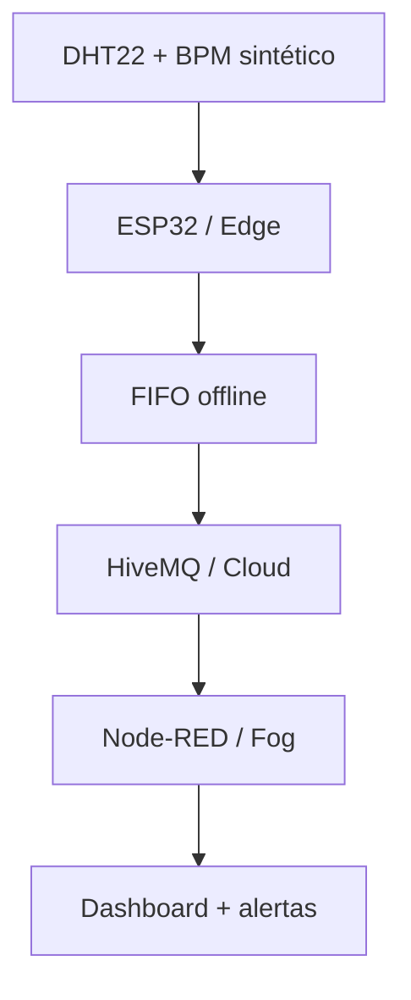

# CardioIA — Fase 3: Monitoramento Contínuo com IoT

Repositório exclusivo para o desenvolvimento, validação e entrega da Fase 3 do projeto CardioIA.

> Estado atual: **Etapas 0 a 6 confirmadas e finalizadas. Etapa 7 em execução desde 25/10/2026.**

- [Abrir o projeto público no Wokwi](https://wokwi.com/projects/478845707855731713)
- [Consultar a conclusão e o índice da Etapa 2](docs/ETAPA_2_CONCLUSAO.md)
- [Abrir a Etapa 3 pública no Wokwi](https://wokwi.com/projects/478851580032675841)
- [Consultar a conclusão da Etapa 3](docs/ETAPA_3_CONCLUSAO.md)
- [Abrir a Etapa 4 pública no Wokwi](https://wokwi.com/projects/478851580032675841)
- [Consultar a validação MQTT da Etapa 4](docs/ETAPA_4_VALIDACAO.md)
- [Consultar a conclusão da Etapa 4](docs/ETAPA_4_CONCLUSAO.md)
- [Abrir o dashboard público](https://cardioia-fase3-dashboard.onrender.com/dashboard/monitoramento)
- [Consultar a validação da Etapa 5](docs/ETAPA_5_VALIDACAO.md)
- [Consultar a conclusão da Etapa 5](docs/ETAPA_5_CONCLUSAO.md)
- [Consultar a validação integrada da Etapa 6](docs/ETAPA_6_VALIDACAO.md)
- [Consultar a conclusão da Etapa 6](docs/ETAPA_6_CONCLUSAO.md)
- [Ler o relatório da Parte 1 — Edge Computing](docs/RELATORIO_EDGE_COMPUTING.md)
- [Ler o relatório da Parte 2 — MQTT e dashboard](docs/RELATORIO_MQTT_DASHBOARD.md)
- [Baixar o PDF da Parte 1](docs/relatorios/CardioIA_Parte_1_Edge_Computing.pdf)
- [Baixar o PDF da Parte 2](docs/relatorios/CardioIA_Parte_2_MQTT_Dashboard.pdf)
- [Baixar a apresentação PowerPoint com links validados](docs/apresentacao/CardioIA_Fase3_Apresentacao_Equipe_Revisao_v5_links_corrigidos.pptx)
- [Abrir a apresentação em PDF com links validados — recomendada para WhatsApp](docs/apresentacao/CardioIA_Fase3_Apresentacao_Equipe_Revisao_v5_WhatsApp_FINAL.pdf)
- [Abrir o checklist de revisão do grupo](docs/ETAPA_7_REVISAO_GRUPO.md)

## Visão geral

O CardioIA simula um dispositivo vestível de monitoramento contínuo. O ESP32
coleta temperatura, umidade e BPM sintético, classifica alertas localmente,
mantém uma fila durante interrupções e envia JSON por MQTT. O Node-RED valida as
mensagens e apresenta gráfico, gauges, estado e alertas no dashboard público.



## Tecnologias

- ESP32 e C++ no Wokwi;
- DHT22, potenciômetro, botão e LED virtual;
- `DHTesp`, `WiFi` e `PubSubClient`;
- MQTT com HiveMQ público e payload JSON versão 1;
- Node-RED 5.0.9 e FlowFuse Dashboard 2.0 1.34.0;
- Render para acesso público ao dashboard;
- testes Python, C++ e JavaScript.

## Estrutura principal

```text
wokwi/       firmware, circuito e bibliotecas
node-red/    flow, runtime e dependências fixadas
data/        exemplo do contrato de telemetria
docs/        arquitetura, relatórios, decisões e validações
evidencias/  capturas e logs organizados por etapa
tests/       validadores e testes automatizados
```

## Execução

### ESP32 no Wokwi

Abra o [projeto público](https://wokwi.com/projects/478851580032675841) e
inicie a simulação. O potenciômetro altera o BPM. O botão azul alterna a
conectividade simulada. Os comandos seriais `O`, `N`, `F` e `R` permitem testar
offline, online, falha do DHT22 e recuperação.

O dashboard é público, mas os dados em tempo real aparecem somente enquanto a
simulação do Wokwi está em execução. Ao abrir o painel com o simulador parado,
o cartão **Dispositivo** mostra `offline — inicie o Wokwi`, que representa o
Last Will MQTT esperado e não uma falha do site. Com telemetria válida, o cartão
reafirma `online (telemetria ativa)` e mostra a fila e os descartes atuais.

Para evitar colisão no broker público durante a demonstração, somente uma pessoa
deve manter a simulação aberta por vez.

### Dashboard local

Com Node.js instalado:

```bash
cd node-red
npm ci
npm start
```

Editor local: `http://127.0.0.1:1880/`

Dashboard local: `http://127.0.0.1:1880/dashboard/monitoramento`

## Limites didáticos

- normal: 50 a 120 BPM, inclusive;
- BPM baixo: abaixo de 50;
- BPM alto: acima de 120;
- temperatura alta: acima de 38,0 °C;
- DHT22 inválido: alerta técnico explícito.

Essas regras servem ao protótipo educacional e não constituem orientação médica.

## Regra principal do projeto

Nenhuma etapa posterior pode ser iniciada antes que a etapa atual:

1. tenha todos os entregáveis produzidos;
2. seja testada pelos critérios definidos;
3. possua evidências verificáveis no repositório;
4. seja revisada quanto a inconsistências;
5. receba uma mensagem explícita de confirmação.

Código existente em rascunhos anteriores pode servir como referência, mas não é considerado validado e não será reutilizado silenciosamente.

## Equipe

| Integrante | RM |
|---|---|
| Fabrício Mouzer Brito | RM566777 |
| Enzo Nunes Castanheira Gloria da Silva | RM567599 |
| Larissa Nunes Moreira Reis | RM568280 |
| Gabriel Rapozo Guimarães Soares | RM568480 |

Os e-mails dos integrantes não serão publicados no repositório.

## Controle por etapas

| Etapa | Objetivo | Estado |
|---|---|---|
| 0 | Governança, repositório e critérios | Confirmada e finalizada em 23/10/2026 |
| 1 | Requisitos e arquitetura | Confirmada e finalizada em 23/10/2026 |
| 2 | Sensores e circuito no Wokwi | Confirmada e finalizada em 25/10/2026; T2-01 a T2-12 aprovados |
| 3 | Resiliência offline no Edge | Confirmada e finalizada em 25/10/2026; T3-01 a T3-13 aprovados |
| 4 | MQTT e broker | Confirmada e finalizada em 25/10/2026; T4-01 a T4-13 aprovados |
| 5 | Dashboard e alertas no Node-RED | Confirmada e finalizada em 25/10/2026; T5-01 a T5-16 aprovados |
| 6 | Teste integrado e evidências | Confirmada e finalizada em 25/10/2026; T6-01 a T6-16 aprovados |
| 7 | Relatórios, apresentação e revisão do grupo | Em execução desde 25/10/2026 |
| 8 | Auditoria final e entrega | Bloqueada |

Consulte [o plano de etapas](docs/PLANO_ETAPAS.md), [os critérios de validação](docs/CRITERIOS_VALIDACAO.md) e [as lições aprendidas](docs/LICOES_APRENDIDAS.md).

## Política de veracidade

- “Preparado” não significa “executado”.
- “Implementado” não significa “validado”.
- Um item só recebe `[x]` quando houver evidência correspondente.
- Prints, logs, links e vídeos devem abrir e demonstrar exatamente o requisito declarado.
- Limitações e falhas devem permanecer documentadas até sua resolução.
- A publicação de um link não encerra uma etapa quando os logs e as capturas exigidos ainda não estiverem preservados.

## Privacidade e segurança

- Somente dados sintéticos serão utilizados.
- Credenciais, senhas, tokens e dados pessoais não serão versionados.
- Brokers públicos não receberão informações clínicas reais.
- O protótipo é educacional e não realiza diagnóstico médico.
