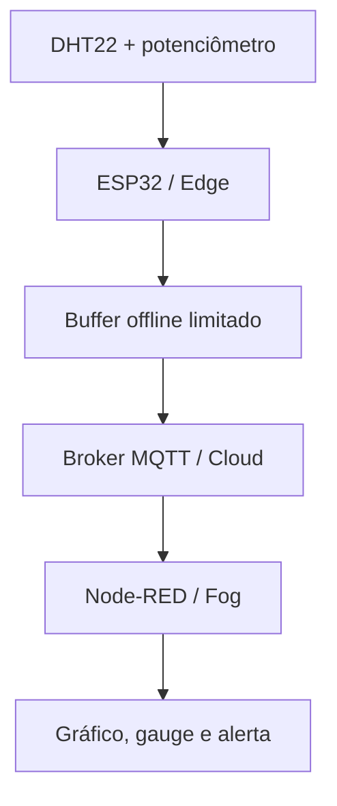

# Etapa 1 — arquitetura proposta para implementação

## Fluxo funcional

## Componentes

| Camada | Componente | Responsabilidade |
|---|---|---|
| Sensoriamento | DHT22 | Temperatura e umidade; conta como um sensor |
| Sensoriamento | Potenciômetro | Segundo sensor; sinal analógico convertido em 40–180 BPM sintéticos |
| Controle | Botão | Forçar indisponibilidade de rede durante o teste; não conta como sensor |
| Edge | ESP32 | Coleta, validação, classificação de alertas, fila e sincronização |
| Evidência local | Monitor Serial | Logs de coleta, fila, perdas, conexão e sincronização |
| Cloud | Broker HiveMQ público | Roteamento MQTT de dados exclusivamente sintéticos |
| Fog | Node-RED | Assinatura, validação, transformação e distribuição das mensagens |
| Visualização | FlowFuse Dashboard 2.0 | Gráfico BPM, gauge de temperatura, status e alertas |

## Sensores e limites

- DHT22 no GPIO15.
- Potenciômetro no ADC GPIO34.
- Botão offline no GPIO4 com `INPUT_PULLUP`.
- LED de alerta no GPIO2.
- Amostragem nominal: cinco segundos.
- BPM sintético: 40 a 180.
- Normal: BPM entre 50 e 120 inclusive e temperatura até 38,0 °C inclusive.
- Alertas: BPM abaixo de 50; BPM acima de 120; temperatura acima de 38,0 °C; falha do DHT22.
- Qualquer alerta acende o LED; o retorno ao normal deve apagá-lo.

Os limites são regras didáticas do protótipo, não recomendações médicas.

## Resiliência Edge

Toda amostra recebe sequência crescente e entra primeiro na fila. Quando MQTT estiver disponível, a sincronização remove as amostras em ordem somente após o cliente aceitar localmente a publicação. Quando a conexão falhar, a coleta continua.

Capacidade escolhida: **2.160 amostras**, equivalentes a três horas com intervalo de cinco segundos. Ao atingir o limite, a amostra mais antiga é substituída e `dropped_samples` é incrementado. A fila em RAM é volátil: fechar ou reiniciar a simulação apaga seu conteúdo.

## MQTT e nuvem

- Broker inicial: `broker.hivemq.com`.
- Porta: `1883`.
- QoS: 0.
- Retain: somente mensagem de status; telemetria e alertas sem retain.
- Prova de entrega: mensagem observada por assinante independente, pois `publish()` aceito localmente não comprova entrega fim a fim.
- Dados permitidos: somente valores sintéticos e identificadores técnicos.

## Fog e dashboard

O Node-RED será instalado apenas na Etapa 5. A decisão de projeto é utilizar `@flowfuse/node-red-dashboard`, sucessor do pacote clássico descontinuado. O flow antigo da PR nº 10 usa nós da versão clássica e não será importado como se estivesse validado.

Widgets mínimos:

1. gráfico temporal de BPM;
2. gauge de temperatura;
3. indicador visual de estado normal/alerta;
4. texto com sequência, origem, fila e descartes.

## Falhas previstas

| Falha | Comportamento esperado |
|---|---|
| DHT22 inválido | Valor sentinela, alerta técnico e continuidade do loop |
| Wi-Fi indisponível | Coleta continua e fila cresce |
| MQTT indisponível | Reconexão periódica sem bloquear a coleta |
| Fila cheia | Descarta mais antiga e registra a perda |
| Payload incompleto | Node-RED rejeita e registra aviso |
| Mensagem duplicada | Sequência permite identificar duplicidade |

## Referências oficiais consultadas

- [FlowFuse Dashboard 2.0 — início](https://dashboard.flowfuse.com/)
- [Migração do Node-RED Dashboard](https://dashboard.flowfuse.com/user/migration.html)
- [Pacote clássico `node-red-dashboard` — aviso de descontinuação](https://flows.nodered.org/node/node-red-dashboard)
- [Wokwi — DHT22](https://docs.wokwi.com/parts/wokwi-dht22)
- [Wokwi — potenciômetro](https://docs.wokwi.com/parts/wokwi-potentiometer)
- [Wokwi — formato do `diagram.json`](https://docs.wokwi.com/diagram-format)
